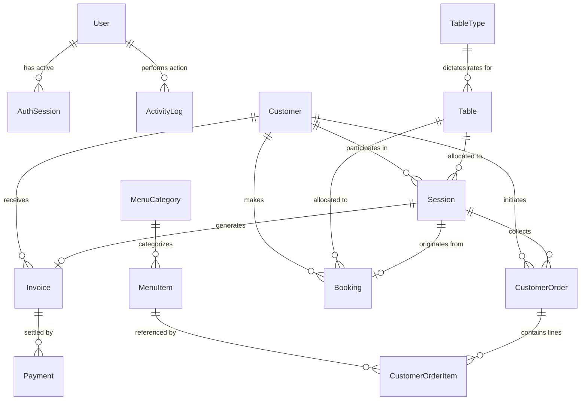

# Database Entity-Relationship Specification

## 1. Schema Diagram
The relationship mapping below represents the relational schema defined in `prisma/schema.prisma`. It maps the logical structure of my PostgreSQL tables, identifying foreign keys, relational constraints, and table scopes.



---

## 2. Table-by-Table Relational Schema & Constraints

### 2.1. Authentication & Security Domain

```
  ┌────────────────────────────────────────────────────────┐
  │                         User                           │
  ├────────────────────────────────────────────────────────┤
  │  id (PK)                   String (CUID)               │
  │  email (Unique)            String                      │
  │  role                      String (Default: STAFF)     │
  │  status                    String (Default: ACTIVE)    │
  └────────────────────────────────────────────────────────┘
        │                        │
        │ 1                      │ 1
        │                        │
        ▼ 0..*                   ▼ 0..*
  ┌──────────────────────┐ ┌──────────────────────────────┐
  │     AuthSession      │ │         ActivityLog          │
  ├──────────────────────┤ ├──────────────────────────────┤
  │  id (PK)             │ │  id (PK)    String (CUID)    │
  │  userId (FK)  String │ │  userId (FK) String          │
  │  token (UQ)   String │ │  entityId   String           │
  └──────────────────────┘ └──────────────────────────────┘
```

#### Table: `User`
Contains data of internal employees (Staff and Admins) authorized to access dashboard workflows.
*   **Relations:**
    *   `authSessions`: `User 1 ── 0..* AuthSession` (Has many active login sessions). Cascade delete rule enforced: if a user account is deleted, all their authentication sessions are destroyed.
    *   `activityLogs`: `User 1 ── 0..* ActivityLog` (Generates many audit entries). Restrict delete rule enforced: a user account cannot be deleted if there are historical logs associated with them, preserving audit trails.

#### Table: `AuthSession`
Tracks session instances generated by Better Auth.
*   **Relations:**
    *   `user`: `AuthSession 0..* ── 1 User` (References the parent user account via `userId`).

#### Table: `ActivityLog`
A security ledger auditing internal staff actions.
*   **Indexes:** `[createdAt]`, `[userId]`, `[entityType]`
*   **Relations:**
    *   `user`: `ActivityLog 0..* ── 1 User` (References the staff user via `userId` who executed the tracked transaction).

---

### 2.2. Table Assets & Sessions Domain

```
  ┌────────────────────────────────────────────────────────┐
  │                       TableType                        │
  ├────────────────────────────────────────────────────────┤
  │  id (PK)                   String (CUID)               │
  │  hourlyRate                Float                       │
  │  minimumCharge             Float                       │
  └────────────────────────────────────────────────────────┘
        │
        │ 1
        ▼ 0..*
  ┌────────────────────────────────────────────────────────┐
  │                         Table                          │
  ├────────────────────────────────────────────────────────┤
  │  id (PK)                   String (CUID)               │
  │  tableTypeId (FK)          String                      │
  │  status                    String                      │
  └────────────────────────────────────────────────────────┘
        │                        │
        │ 1                      │ 1
        ▼ 0..*                   ▼ 0..*
  ┌──────────────────────┐ ┌──────────────────────────────┐
  │       Session        │ │           Booking            │
  ├──────────────────────┤ ├──────────────────────────────┤
  │  id (PK)             │ │  id (PK)                     │
  │  tableId (FK) String │ │  tableId (FK)               │
  │  status       String │ │  status                      │
  └──────────────────────┘ └──────────────────────────────┘
```

#### Table: `TableType`
Determines the operational rates for categories of physical assets.
*   **Relations:**
    *   `tables`: `TableType 1 ── 0..* Table` (Defines the pricing rules for physical instances). Restrict delete: you cannot delete a pricing category if physical tables are still assigned to it.

#### Table: `Table`
Physical play areas (Pool, PS5) that track session allocation.
*   **Soft Delete:** `isArchived` flag — archived tables stop appearing in the grid and session creation, but all historical sessions remain.
*   **Indexes:** `[status]`
*   **Relations:**
    *   `tableType`: `Table 0..* ── 1 TableType` (Retrieves rates via `tableTypeId` relation).
    *   `bookings`: `Table 1 ── 0..* Booking` (Reserved in advance).
    *   `sessions`: `Table 1 ── 0..* Session` (Hosts play sessions).

#### Table: `Session`
Stores billing state, pause duration counters, and play metrics.
*   **Indexes:** `[status]`
*   **Relations:**
    *   `table`: `Session 0..* ── 1 Table` (Runs on a physical asset via `tableId`).
    *   `customer`: `Session 0..* ── 0..1 Customer` (Linked to a patron record via `customerId`, or null if walk-in guest).
    *   `booking`: `Session 0..1 ── 0..1 Booking` (Can originate from a reservation via `bookingId`).
    *   `orders`: `Session 1 ── 0..* CustomerOrder` (Accumulates cafe orders via `sessionId`).
    *   `invoice`: `Session 1 ── 0..1 Invoice` (Generates a final invoice).

---

### 2.3. Cafe Inventory Domain

```
  ┌────────────────────────────────────────────────────────┐
  │                      MenuCategory                      │
  ├────────────────────────────────────────────────────────┤
  │  id (PK)                   String (CUID)               │
  │  name                      String                      │
  └────────────────────────────────────────────────────────┘
        │
        │ 1
        ▼ 0..*
  ┌────────────────────────────────────────────────────────┐
  │                        MenuItem                        │
  ├────────────────────────────────────────────────────────┤
  │  id (PK)                   String (CUID)               │
  │  categoryId (FK)           String                      │
  │  basePrice                 Float                       │
  └────────────────────────────────────────────────────────┘
        │
        │ 1
        ▼ 0..*
  ┌────────────────────────────────────────────────────────┐
  │                   CustomerOrderItem                    │
  ├────────────────────────────────────────────────────────┤
  │  id (PK)                   String (CUID)               │
  │  menuItemId (FK)           String                      │
  │  unitPriceSnapshot         Float                       │
  └────────────────────────────────────────────────────────┘
```

#### Table: `MenuCategory`
Grouping index for catalog organization.
*   **Relations:**
    *   `menuItems`: `MenuCategory 1 ── 0..* MenuItem` (Has catalog items).

#### Table: `MenuItem`
Individual food and beverage entries.
*   **Relations:**
    *   `category`: `MenuItem 0..* ── 1 MenuCategory` (Points to category metadata via `categoryId`).
    *   `orderItems`: `MenuItem 1 ── 0..* CustomerOrderItem` (Referenced in sales history). Restrict delete rule: you cannot delete a menu item from the system if an invoice depends on its ID for historical reports.

---

### 2.4. Orders & Invoicing Domain

```
  ┌────────────────────────────────────────────────────────┐
  │                     CustomerOrder                      │
  ├────────────────────────────────────────────────────────┤
  │  id (PK)                   String (CUID)               │
  │  sessionId (FK, Opt)       String                      │
  │  total                     Float                       │
  └────────────────────────────────────────────────────────┘
        │
        │ 1
        ▼ 0..*
  ┌────────────────────────────────────────────────────────┐
  │                   CustomerOrderItem                    │
  ├────────────────────────────────────────────────────────┤
  │  id (PK)                   String (CUID)               │
  │  orderId (FK)              String                      │
  │  unitPriceSnapshot         Float                       │
  └────────────────────────────────────────────────────────┘
```

#### Table: `CustomerOrder`
Aggregated items mapped to a walk-in check or table session.
*   **Indexes:** `[createdAt]`, `[status]`, `[sessionId]`
*   **Relations:**
    *   `session`: `CustomerOrder 0..* ── 0..1 Session` (Attached to an active table via `sessionId`).
    *   `customer`: `CustomerOrder 0..* ── 0..1 Customer` (Optionally linked to a customer).
    *   `orderItems`: `CustomerOrder 1 ── 0..* CustomerOrderItem` (Contains item detail lines). Cascade delete enforced: removing an order record purges its line items.

#### Table: `CustomerOrderItem`
Line details housing hard-coded price and name snapshots to protect billing calculations.
*   **Relations:**
    *   `order`: `CustomerOrderItem 0..* ── 1 CustomerOrder` (Belongs to order via `orderId`).
    *   `menuItem`: `CustomerOrderItem 0..* ── 1 MenuItem` (Reference link).

#### Table: `Invoice`
Central receipt aggregating calculations at session end.
*   **Soft Delete:** `isArchived` flag — invoices are **never hard-deleted**. Setting `isArchived: true` hides them from list views, reports, and customer profiles while preserving the underlying record. Ensures sequential `invoiceNumber` integrity and full financial audit trails.
*   **Indexes:** `[createdAt]`, `[status]`, `[isArchived]`, `[customerId]`
*   **Relations:**
    *   `session`: `Invoice 0..1 ── 0..1 Session` (Points back to play session via `sessionId`).
    *   `customer`: `Invoice 0..* ── 0..1 Customer` (Linked to a customer profile via `customerId`).
    *   `payments`: `Invoice 1 ── 0..* Payment` (Can be paid in parts). Cascade delete: if invoice is archived, payment logs are preserved.

#### Table: `Payment`
Log entries capturing transactions.
*   **Indexes:** `[paidAt]`, `[invoiceId]`
*   **Relations:**
    *   `invoice`: `Payment 0..* ── 1 Invoice` (Clears balance via `invoiceId`).

---

## 3. Relational Workflows (Checkout Walkthrough)
When a table session is ended:
1.  `Session` maps to `TableType` via `Table` to pull current hourly rates.
2.  `Session` fetches all associated `CustomerOrder` rows where `sessionId` matches.
3.  Each `CustomerOrder` gathers the sum of its `CustomerOrderItem` entries.
4.  Prisma calculates total charge:
    $$\text{Grand Total} = \text{Session Cost} + \sum \text{CustomerOrder.total}$$
5.  An `Invoice` is created with `status: UNPAID`.
6.  The `Session` status changes to `COMPLETED` and the `Table` status resets to `AVAILABLE`.
7.  The user records a `Payment` against the `Invoice`, updating the invoice state to `PAID`.
8.  The linked `Customer.totalSpend` is incremented atomically within the same Prisma transaction.

---

## 4. Soft-Delete Workflow
When "Delete" is triggered for a Customer or Invoice from the dashboard UI:
1.  A server action calls a Prisma `update()` setting `isArchived: true`.
2.  All service-layer `findMany` / `findFirst` queries filter `{ isArchived: false }` — the row becomes invisible to the app.
3.  All historical invoices, payments, and audit logs referencing the archived entity remain fully intact in the database.
4.  No cascade deletes are triggered; no `invoiceNumber` gaps are created.
5.  A corresponding `ActivityLog` entry is written recording who performed the archive action and when.
