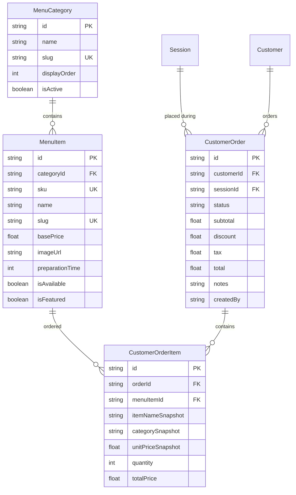
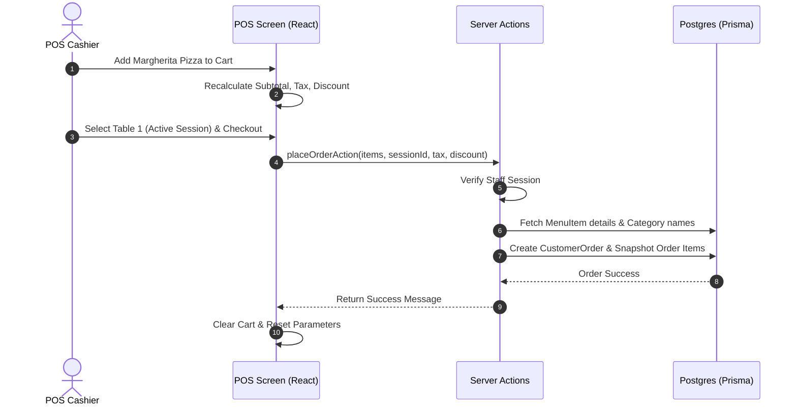

# Feature Documentation: Food & Beverage (Cafe POS) Module

This document outlines the architecture, database design, API specification, security rules, and testing guide for the Food & Beverage (Cafe POS) Module.

---

## 1. Database Design

We redesigned the Cafe database model structure in Prisma to support categories and ensure financial historical integrity.

### Snapshot Billing Integrity
When a food order is placed, we snapshot the `itemNameSnapshot`, `categorySnapshot`, and `unitPriceSnapshot` inside the `CustomerOrderItem` table. 
* **Reason:** If an admin changes a Pizza's price from ₹250 to ₹300 tomorrow, old orders and closed invoices must still calculate and show the original purchase price of ₹250.

---

## 2. API Reference (Server Actions)

We implement clean server actions under `features/pos/actions/`.

### Category Server Actions (`category.actions.ts`)
* `createCategoryAction(data: CategoryFormValues)`: Creates a new menu category. Enforces admin-only security.
* `updateCategoryAction(id: string, data: CategoryFormValues)`: Modifies category details or visibility toggle.
* `deleteCategoryAction(id: string)`: Deletes a category if no items are linked.

### Menu Item Server Actions (`item.actions.ts`)
* `createMenuItemAction(data: MenuItemFormValues)`: Creates a new product. Checks for unique SKU and slug. Admin-only.
* `updateMenuItemAction(id: string, data: MenuItemFormValues)`: Updates product settings.
* `toggleItemAvailabilityAction(id: string, isAvailable: boolean)`: Toggles availability switch.
* `deleteMenuItemAction(id: string)`: Fully deletes item if never ordered, or disables it if order history exists.

### Order Server Actions (`pos.actions.ts`)
* `placeOrderAction(data: PlaceOrderValues)`: Validates cart item quantities and places the order. Enforces standard session auth.

---

## 3. Order & POS Flow

Below is the workflow from ordering to final checkout:

---

## 4. Security Rules
1. **Admin Only:** Only users with `role === "ADMIN"` can invoke create, update, or delete server actions for menu categories and menu items.
2. **Staff Access:** Users with `role === "STAFF"` can browse the POS, add items, and place checkout orders.
3. **Data Protection:** Client inputs are parsed and validated against strict Zod schemas on the server side. Never trust pricing payloads sent from the client; pricing is always pulled directly from the secure database during order calculation.

---

## 5. Testing Guide

### Test Case 1: Historical Billing Integrity
1. Create a menu item "Cold Coffee" for ₹120.
2. Place an order for 2 "Cold Coffees" linked to Table 1 (Total: ₹240).
3. Go to Menu Management, edit "Cold Coffee", change price to ₹150.
4. End session for Table 1.
5. **Verify:** Check Invoice details. The cafe charge should be exactly ₹240 (original ₹120 price), NOT ₹300.

### Test Case 2: SKU Uniqueness Rule
1. Add a menu item with SKU `SNK-GBREAD`.
2. Try adding another menu item with SKU `SNK-GBREAD`.
3. **Verify:** System throws a validation error "Item with SKU SNK-GBREAD already exists" and rejects insertion.
