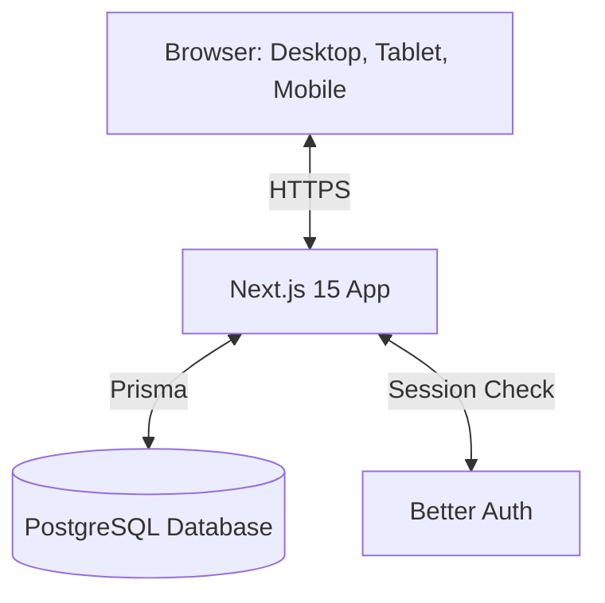

# Software Architecture

## High-Level Idea
We are building this using Next.js 15 (App Router). The idea is to keep things very clean. We will use Next.js Server Components to fetch data and Client Components only when we need user interaction like clicks or live timers.

## How the Code is Organized (Feature-Based)
Instead of putting all components in one folder, we keep them grouped by feature inside the `app/` folder.

1. **UI Layer:** This is built with React, Tailwind CSS, and shadcn/ui.
2. **Server Actions Layer:** When a form is submitted, it calls a Server Action. This acts like our API.
3. **Business Logic Layer:** Simple TypeScript functions that do the math (like calculating bill amounts or checking if a table is free).
4. **Database Layer:** We use Prisma to talk to PostgreSQL. The UI never talks to Prisma directly.
5. **Validation:** We use Zod to check if the data sent by the user is correct before we save it.

## How Components Talk to Each Other
- **Server Components:** These load the data directly from Prisma and pass it down. They load fast.
- **Client Components:** These handle the live timers, clicking buttons, and showing modals.
- **Forms:** We use `react-hook-form` with Zod to handle inputs.

## Example: Starting a Session
1. Staff clicks the "Start Session" button on the screen.
2. The browser calls a Next.js Server Action with the Table ID.
3. Zod checks if the Table ID is valid.
4. Better Auth checks if the Staff member is logged in.
5. The Business Logic checks if the table is actually empty in the database.
6. Prisma saves the new session in the database.
7. Next.js refreshes the page so the table shows as "Occupied".

## Timer Logic
We don't want to kill the database by updating the timer every second.
So, the database only stores the `startTime`.
The browser (Client Component) just looks at the clock and shows how much time has passed.
