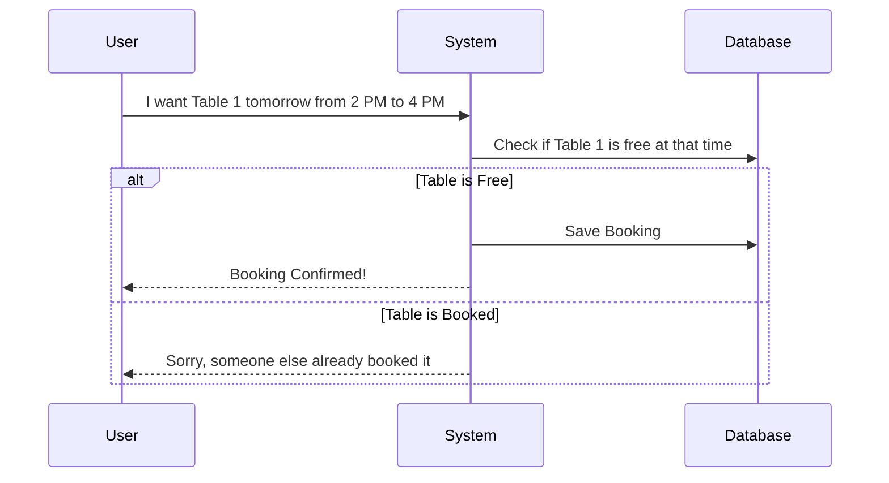

# System Design

## Overall Design
The software is a single web application. The main focus is to make sure billing is 100% correct and the UI is very fast for the staff to use during rush hours.

## How Main Features Work

### 1. Booking a Table

### 2. The Timer Logic
**Very Important:** We do NOT update the database every second.
- **When Game Starts:** Save the `startTime` in the DB.
- **While Playing:** The browser just does `Current Time - startTime` to show the timer on the screen.
- **When Paused:** We calculate how many seconds they played so far, and save it in the DB as `totalPauseDurationSeconds`. Then we clear the start time.
- **When Game Ends:** The backend calculates the exact time they played and locks the session.

### 3. Billing Logic
When the customer says "I am done", this happens:
1. System calculates total minutes played.
2. It looks at the Table's hourly price (like ₹100 per hour).
3. It does the math to find the game cost.
4. It checks if they ordered any Pepsi or snacks.
5. It adds everything up, adds GST (tax) if needed, and creates a final Invoice.

### 4. Performance Plan
- We will not load all 10,000 old invoices on the dashboard. We only load what is active today.
- We will use indexes in PostgreSQL so searching for a customer's phone number is very fast.
